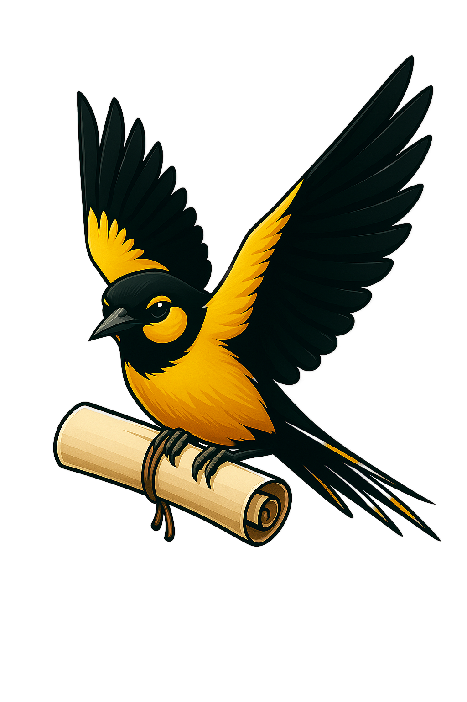

# NeedleTailIRC

A Swift package for parsing, encoding, and framing IRC (Internet Relay Chat) messages with modern concurrency support.

[](https://swift.org)
[](https://developer.apple.com)
[](LICENSE)

## Overview

NeedleTailIRC is a type-safe IRC protocol layer for the NeedleTail stack. It covers message parsing and encoding (RFC 2812, RFC 1459), IRCv3 message tags, multipart text chunking, length-prefixed binary frames, self-delimiting DCC frames, and NIO writer integration. It does **not** include socket/TLS connection management — you provide the transport and write `IRCFrame` values through your own NIO pipeline.

## Features

- **Parse & encode IRC wire format**: `NeedleTailIRCParser` and `NeedleTailIRCEncoder`
- **One socket unit**: `IRCFrame` is `.text(IRCMessage)`, `.binary(IRCBinaryMessage)`, or `.dcc(DCCMessage)`
- **IRCv3 message tags**: Tag parsing, escaping, and round-trip encoding
- **Type-safe commands & models**: `IRCCommand`, `NeedleTailChannel`, `NeedleTailNick`, and related types
- **Multipart text framing**: `IRCMessageGenerator` and `PacketBuilder` for large text payloads (`packet-metadata` tags)
- **Binary payloads**: `IRCBinaryMessage` carries opaque bytes on the server connection without base64 or line limits
- **DCC frames**: Encode/decode bounded, self-delimiting `DCCMessage` frames (not a full file-transfer client)
- **NIO integration**: `IRCFrameEncoder`, `IRCFrameDecoder`, and `NeedleTailWriterDelegate`
- **Custom commands**: Declare application commands as `IRCCustomCommand`, send them with `IRCCommand.custom(_:_:)`, and match them in a `switch`
- **Outbound validation**: `IRCMessage.validateWireLine()` rejects a line that would break RFC 2812 or IRCv3 tags before anything is written

## Quick Start

### Installation

Add NeedleTailIRC to your project using Swift Package Manager:

```swift
dependencies: [
    .package(url: "https://github.com/needletails/needletail-irc.git", from: "3.0.0")
]
```

### Basic Usage

```swift
import NeedleTailIRC

// Create an IRC message
let message = IRCMessage(
    origin: "alice",
    command: .privMsg([.channel(NeedleTailChannel("#general")!)], "Hello, world!")
)

// Parse an IRC message string
let parsedMessage = try NeedleTailIRCParser.parseMessage(
    ":alice!alice@localhost PRIVMSG #general :Hello, world!"
)

// Encode a message to string format (synchronous)
let encodedString = NeedleTailIRCEncoder.encode(value: message)
```

### Sending Large Messages

`IRCMessageGenerator` splits oversized payloads into multipart IRC messages. Reassemble inbound chunks with `messageReassembler(ircMessage:)`.

```swift
let generator = IRCMessageGenerator(executor: executor)
let stream = await generator.createMessages(
    origin: "alice!user@host",
    command: .privMsg([.channel(NeedleTailChannel("#general")!)], largePayload),
    logger: NeedleTailLogger()
)

for try await message in stream {
    let line = NeedleTailIRCEncoder.encode(value: message)
    // Write `line` through your NIO outbound writer or socket layer.
}

// On receive:
if let rebuilt = try await generator.messageReassembler(ircMessage: incomingMessage) {
    await handleMessage(rebuilt)
}
```

> **Note:** Line length isn't checked by default, because NeedleTail sends lines larger than 512 bytes. On a connection to a standard IRC network, return `IRCLineLimits.standardClient` (or `.standardServer`) from your writer delegate's `outboundLineLimits`. A line that would break RFC 2812's 512 bytes, or IRCv3's tag limit, then throws before it is written.

## Architecture

### Core Components

- **Parsing**: `NeedleTailIRCParser` — raw IRC strings to `IRCMessage`
- **Encoding**: `NeedleTailIRCEncoder` — `IRCMessage` to wire-format strings
- **Commands**: `IRCCommand` — typed representation of IRC commands and numerics
- **Models**: Channels, nicks, tags, permissions, and error types
- **Multipart**: `IRCMessageGenerator`, `PacketBuilder`, `MultipartPacket`
- **Transport hook**: `NeedleTailWriterDelegate` — bridges message generation to NIO writers

### Key Types

- `IRCMessage` — complete IRC message representation
- `IRCCommand` — type-safe IRC command enum
- `NeedleTailChannel` — validated channel name
- `NeedleTailNick` — validated nickname (with optional device UUID suffix)
- `IRCTag` — IRCv3 message tag
- `IRCMessageGenerator` — multipart encode path
- `NeedleTailWriterDelegate` — NIO outbound transport helper

## Examples

### Channel Operations

```swift
// Join a channel
let joinCommand = IRCCommand.join(
    channels: [NeedleTailChannel("#general")!],
    keys: nil
)

// Send a message to a channel
let message = IRCMessage(
    command: .privMsg([.channel(NeedleTailChannel("#general")!)], "Hello, everyone!")
)

// Set channel modes
let modeCommand = IRCCommand.channelMode(
    NeedleTailChannel("#general")!,
    addMode: .inviteOnly,
    addParameters: nil,
    removeMode: nil,
    removeParameters: nil
)
```

### User Operations

```swift
// Change nickname
let nickCommand = IRCCommand.nick(NeedleTailNick(name: "newNick", deviceId: UUID())!)

// Set user mode
let modeCommand = IRCCommand.mode(
    NeedleTailNick(name: "alice", deviceId: UUID())!,
    add: [.invisible, .away],
    remove: nil
)

// Get user information
let whoisCommand = IRCCommand.whois(server: nil, usermasks: ["alice"])
```

### Multipart Messages

```swift
let generator = IRCMessageGenerator(executor: executor)
let stream = await generator.createMessages(
    origin: "alice",
    command: .privMsg([.channel(NeedleTailChannel("#general")!)], largeMessage),
    logger: NeedleTailLogger()
)

for try await chunk in stream {
    let line = NeedleTailIRCEncoder.encode(value: chunk)
    try await writeToTransport(line)
}
```

## Error Handling

```swift
do {
    let message = try NeedleTailIRCParser.parseMessage(rawMessage)
    // Process the message
} catch NeedleTailError.invalidIRCChannelName {
    print("Invalid channel name")
} catch NeedleTailError.nilNickName {
    print("Invalid nickname")
} catch MessageParsingErrors.invalidArguments(let details) {
    print("Invalid arguments: \(details)")
} catch MessageParsingErrors.invalidTag {
    print("Invalid tag format")
} catch {
    print("Unknown parsing error: \(error)")
}
```

## Documentation

Release history is in [CHANGELOG.md](CHANGELOG.md). API documentation lives in [Documentation.docc](Sources/NeedleTailIRC/Documentation.docc):

- [Getting Started](Sources/NeedleTailIRC/Documentation.docc/GettingStarted.md) — installation and first messages
- [Basic Usage](Sources/NeedleTailIRC/Documentation.docc/BasicUsage.md) — core concepts and patterns
- [Message Format](Sources/NeedleTailIRC/Documentation.docc/MessageFormat.md) — IRC message structure
- [Message Handling](Sources/NeedleTailIRC/Documentation.docc/MessageHandling.md) — processing messages
- [IRC Commands](Sources/NeedleTailIRC/Documentation.docc/IRCCommands.md) — command reference
- [Channels](Sources/NeedleTailIRC/Documentation.docc/Channels.md) — channel management
- [Users](Sources/NeedleTailIRC/Documentation.docc/Users.md) — user management and permissions
- [Multipart Messages](Sources/NeedleTailIRC/Documentation.docc/MultipartMessages.md) — large message handling
- [Transport Layer](Sources/NeedleTailIRC/Documentation.docc/TransportLayer.md) — NIO writer integration
- [Error Handling](Sources/NeedleTailIRC/Documentation.docc/ErrorHandling.md) — error types and strategies
- [API Reference](Sources/NeedleTailIRC/Documentation.docc/APIReference.md) — public API overview

## Requirements

- **Swift**: 6.4+
- **Platforms**: iOS 18.0+, macOS 15.0+
- **Xcode**: 27.0+ (for Apple platform development)

## Dependencies

NeedleTailIRC pulls in:

- `swift-nio` — NIOCore
- `swift-algorithms` — algorithm utilities
- `swift-log` — logging API used by transport integration
- `needletail-logger` — logging
- `needletail-algorithms` — NeedleTailAsyncSequence and related utilities
- `binary-codable` — binary serialization for `packet-metadata` and auth tags on the text path

## API and wire semantics

- `NeedleTailNick.stringValue` emits `name_UUID` when a device identifier exists and a standard `name` otherwise.
- `IRCUserIdentifier.stringValue` emits `nick[!user][@host]`.
- `IRCMessage` and `IRCBinaryMessage` equality is identity-based (`id`); `IRCTag` equality is key-based. Compare protocol fields explicitly when value equality is required.
- `NeedleTailIRCParser.parseMessage(_:)` preserves the historical unbounded tag behavior. Use `parseMessage(_:limits:)` with `.standardIRC` for untrusted standard-IRC input.
- A socket speaks `IRCFrame`. The leading byte selects the family: `0xFF` is `IRCBinaryMessage`, `0x00...0x04` is `DCCMessage`, anything else is an `IRCMessage` line.
- Every variable-length `DCCMessage` field, including `serviceName`, is `UInt32` length-prefixed. `serviceName` changed in 2.0.0; both ends of a DCC connection must update together.
- Choose a decoder per socket: `lineBasedIRC()` (text only), `serverIRC()` (text plus binary, no DCC), `withBinaryFrames()` (all three).
- `createMessages` still chunks large text into base64 `packet-metadata` tags. Application payloads that should avoid that overhead belong in `IRCBinaryMessage`.
- Lines split by RFC 2812: single-word middle parameters, then one trailing parameter kept verbatim. A command without a typed `IRCCommand` case arrives as `.otherCommand(name, parameters)`, and any command can be sent the same way.
- A numeric with `target` set is written in RFC form (`:srv 433 alice bob :Nickname is already in use`). Without a target it keeps the NeedleTail form (`465 :DEVICE_REVOKED, <uuid>`), which the parser still splits on commas. `transportMessage` and `createMessages` take an optional `target`.
- Outbound lines are checked by `IRCMessage.validateWireLine()`. The command must be letters or three digits, the origin has no space, tag keys are `[+][vendor/]name`, every parameter before the last is one word that doesn't start with `:`, and there are at most 15 parameters. `sendAndFlushMessage` runs the check before writing, so a bad line throws an `IRCMessageGeneratorError` to the caller and the connection stays usable. `wireLine()` also strips NUL, CR and LF.
- Application commands are `IRCCustomCommand` values the app declares: `.custom(.badgeUpdate, ["3"])` to send, `case .otherCommand(IRCCustomCommand.badgeUpdate, let arguments)` to match. The NeedleTail commands in `Constants` (`badgeUpdate`, `offlineMessages`, the media commands and so on) still work but are deprecated. `IRCMessageGenerator(executor:largePayloadCommands:)` names the commands chunked 5 MB at a time; the default is the two media commands.
- Nicks read off the wire keep their case and compare without case (RFC 2812 §2.2), so `:Bob PRIVMSG Alice` re-encodes unchanged. A NeedleTail `name_UUID` nick stays lowercased. `PART` with a message parses as `.partMessage(channels:message:)`. A server CAP reply that `.cap` can't hold (`LS *`, `NEW`, `DEL`) keeps its target. A last parameter may hold spaces: `OPER boss :correct horse`.
- `IRCMessageRecipient.mask` carries the other RFC 2812 message targets as sent: `$*.example.net`, `nick!user@host`, `user%host@server`, `user%host` and `user@server`. Lines addressed to them parse instead of being dropped.
- `IRCLineLimits` sets opt-in size limits: `maxLineBytes` for the line without its tags, CRLF included, and `maxTagBytes` for the tag section. Pass them to `validateWireLine(limits:)`, or return them from `NeedleTailWriterDelegate.outboundLineLimits`, which defaults to `nil` (no limits).
- `ISON` with more than 15 nicks writes the rest as one trailing parameter. User `MODE` is one mode string (`+iw-o`). A bare `LIST` asks for every channel. `USER` with mode flags writes the RFC 2812 bitmask (`USER alice 8 * :Real`).
- `IRCEventProtocol` supplies no-op defaults for every callback. Override every event your integration needs.

## Installation

### Swift Package Manager

```swift
dependencies: [
    .package(url: "https://github.com/needletails/needletail-irc.git", from: "3.0.0")
]
```

### Xcode

1. Go to **File** → **Add Package Dependencies**
2. Enter: `https://github.com/needletails/needletail-irc.git`
3. Select the version you want
4. Add to your target

## Contributing

See [CONTRIBUTING.md](CONTRIBUTING.md).

## License

MIT — see [LICENSE](LICENSE).

## Support

- **Documentation**: [Documentation.docc](Sources/NeedleTailIRC/Documentation.docc)
- **Issues**: [GitHub Issues](https://github.com/needletails/needletail-irc/issues)

## Acknowledgments

- IRC protocol specifications (RFC 2812, RFC 1459)
- IRCv3 extension specifications
- The Swift community
